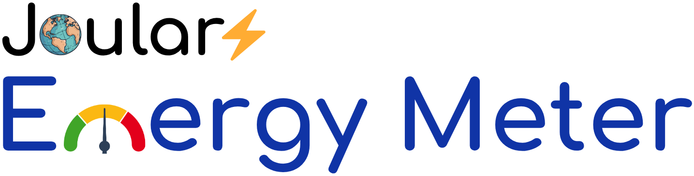
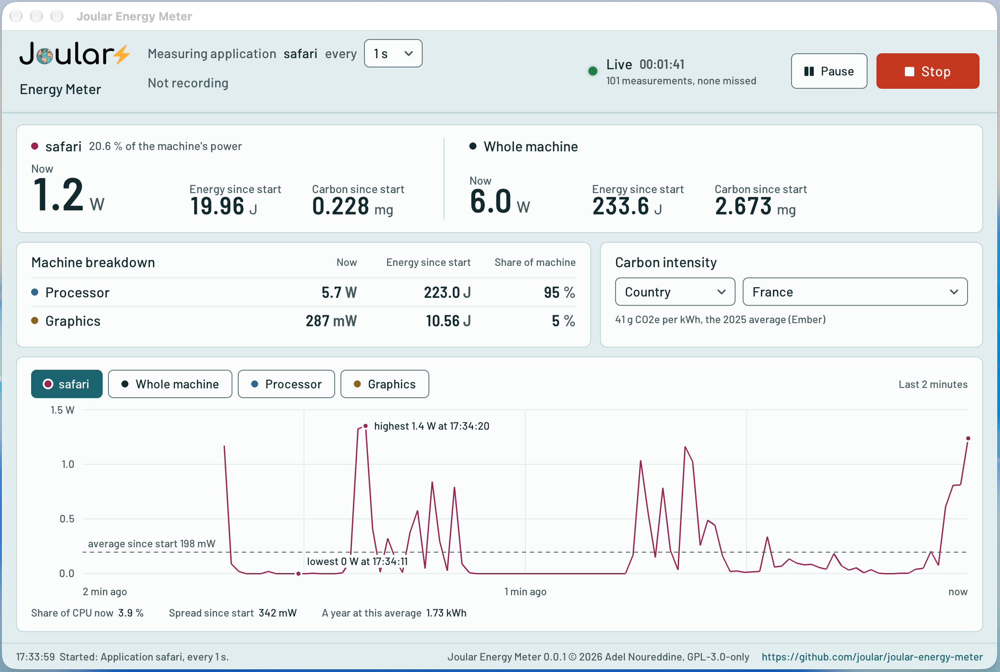

# Overview

Joular Energy Meter is a desktop application that monitors, in real time, the power and energy consumption of your computer (CPU and GPU) and of a process or application, on Windows, Linux, macOS and FreeBSD.
It also estimates the carbon emissions and the cost of that energy.

Joular Energy Meter is part of the  project.

Like [PowerJoular](https://github.com/joular/powerjoular), it does the measuring through two Ada libraries we developed, [Joular Core](https://github.com/joular/joularcore) for the energy of the CPU and the GPU, and [CPU Load](https://github.com/joular/cpuload) for the CPU usage.
The application itself is written in C with [LVGL](https://lvgl.io) and SDL2, so it looks and works the same on every system.

The official website of Joular Energy Meter is: [https://www.noureddine.org/research/joular/energymeter](https://www.noureddine.org/research/joular/energymeter).

## Features

- Monitor the power and energy of the CPU, the GPU and the whole machine
- Monitor a process, an application (all its processes), or a command started from the application
- Estimate carbon emissions with the carbon intensity of your country's electricity (from [Ember](https://ember-energy.org)), of an energy source, or your own value, and the cost of the energy
- Measure the idle power of the machine, to see what a program adds to it
- Read a power meter at the plug, through the CSV file its program writes
- Save the power data to CSV files, in the same format as PowerJoular
- The same application on Linux, Windows, macOS and FreeBSD

## License

Joular Energy Meter is licensed under the GNU GPL 3 license only (GPL-3.0-only).

Copyright (c) 2026, Adel Noureddine.
All rights reserved. This program and the accompanying materials are made available under the terms of the GNU General Public License v3.0 only (GPL-3.0-only) which accompanies this distribution, and is available at: https://www.gnu.org/licenses/gpl-3.0.en.html

The third-party works shipped with Joular Energy Meter (LVGL, SDL2, the fonts and icons, Ember's carbon intensity data) are listed with their licences in the [README](https://github.com/joular/joular-energy-meter#newspaper-license).

Author : [Adel Noureddine](https://www.noureddine.org/)
