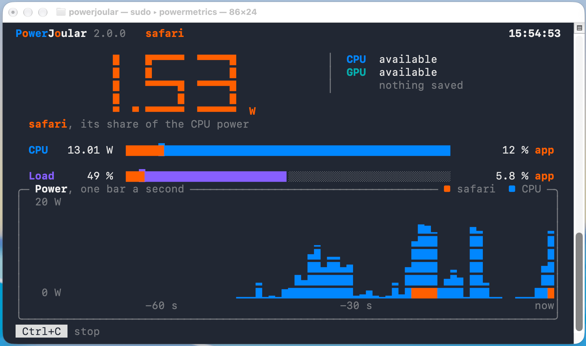

# Quick Usage

To use PowerJoular, just run the command ```powerjoular``` (or ```powerjoular.exe``` on Windows).
On Linux PC/servers, PowerJoular uses Intel's RAPL through the Linux powercap sysfs, and therefore requires root/sudo access on the latest Linux kernels (5.10 and newer): ```sudo powerjoular```.
On macOS, ```powermetrics``` also requires root/sudo access: ```sudo powerjoular```.
On FreeBSD, reading RAPL needs the ```cpuctl``` module (```kldload cpuctl```) and root/sudo access: ```sudo powerjoular```.
On Windows and Raspberry Pi, no special access is needed, except with the PawnIO driver on Windows, which needs a terminal with administrative rights (see [Supported Platforms](./supported_platforms.html)).

By default, the software shows its name and version, then the total power consumption, the power of the CPU and of the GPU (when there is one), and the CPU load, on one line of the terminal rewritten every second, until Ctrl+C:

```
Total  18.45 W | CPU  15.20 W | GPU   3.25 W | load ███░░░░░░░  25 %
```

To monitor a specific application, just run PowerJoular with the ```-a appName``` parameter, or with ```-p pid``` for a specific process.
The line then shows the application or the process: its share of the CPU power, its power ```of``` the power of the whole CPU, and its CPU usage ```of``` the load of the whole machine:

```
firefox | CPU █░░░░░░░░░  13 % |  1.92 of 15.20 W | usage  3.1 of 25 %
```

When the output is a file or a pipe, each measurement is a line of plain text instead (see [Exporting Power Data](../ref/exports.html)).

For a visual TUI on the whole terminal, with the power in large digits, bars and a chart, add ```-i```:



To save the power data to a CSV file, add ```-f filename```, or ```-o filename``` to keep only the latest values in the file.
When a file (or the ring buffer, with ```-r```) is given, PowerJoular no longer prints on the terminal: add ```-t``` (or ```-i```) to print there too.

PowerJoular is a powerful tool with many functionalities that can be accessed using specific parameters. Check the [Command Line Options page](../ref/options.html) for the detailed list. 