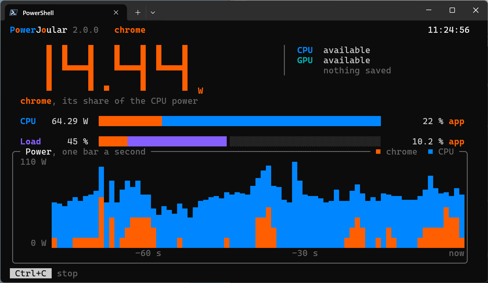

# Exporting Power Data

PowerJoular exports its power data to the terminal, to CSV files, and to a shared memory ring buffer.
The CSV files and the ring buffer can be used at the same time, and with the terminal when ```-t``` or ```-i``` is given.

## Terminal

With no option, PowerJoular shows its name and version, then the power of the machine, once a second, on one line rewritten in place:

```
Total  18.45 W | CPU  15.20 W | GPU   3.25 W | load ███░░░░░░░  25 %
```

The GPU is only shown when one was found. The meter is the CPU load of the machine. Set ```NO_COLOR``` to turn the colours off.

When monitoring a process (```-p```) or an application (```-a```), the line shows the process instead: the share of the CPU power that is its own, its power ```of``` the power of the whole CPU, and its CPU usage ```of``` the load of the whole machine (the GPU is not shown):

```
PID 144 | CPU █░░░░░░░░░  13 % |  1.92 of 15.20 W | usage  3.1 of 25 %
```

```n/a``` is shown when the process or the application could not be read.

When the output is not a terminal (a file or a pipe), each measurement is a line of plain text, the same as in version 1, which scripts can read:

```
Total Power: 18.45 Watts (CPU: 15.20 W, GPU: 3.25 W)
PID monitoring:	CPU: 3.10 % (24.60 %)	1.92 Watts (15.20 Watts)
Application monitoring:	CPU: 3.10 % (24.60 %)	1.92 Watts (15.20 Watts)
```

### Visual TUI

```-i``` shows the visual TUI on the whole terminal: the power in large digits, a bar for the CPU and the GPU when there is a GPU (with ```-p``` or ```-a```, the process's share of the CPU), a bar for the load, and a chart with one bar a second.
A side panel lists what was found (CPU, GPU) and what is being written (```-f```, ```-o```, ```-r```).



It works with every option, and stops with Ctrl+C. ```NO_COLOR``` turns its colours off too.
Messages that come while it is shown are printed when it closes.
A window smaller than 50 by 16 gets the ```-t``` line instead, and a pipe or a file gets exactly what ```-t``` prints.

## CSV files

```-f``` adds a row every second to the file, and starts a new or empty file with a header (an existing file is added to, not emptied):

```
Timestamp,CPU Usage,Total Power,CPU Power,GPU Power
1756681930,0.2460,18.4500,15.2000,3.2500
```

The time of the measurement is a Unix timestamp in seconds, the CPU usage goes from 0.0 to 1.0, and the power is in watts.

When monitoring a process or an application, a second file is written, named after the PID or the application name (```power-144.csv``` for ```-p 144 -f power.csv```).
It has the CPU usage and the power of that process or application:

```
Timestamp,CPU Usage,CPU Power
1756681930,0.0310,1.9154
```

```-o``` writes the latest measurement only: the file is rewritten every second and carries no header, which is a good option for another program polling it for the current value.

Both value columns of the process file hold ```-1.0000``` for a second where the monitored process could not be read at all: it has stopped, or the system does not let us get the information needed.
That is not the same as ```0.0000```, which means a process that was read and used no CPU time.

```-a``` is the exception: an application with no running process at all is reported as ```0.0000``` and not as ```-1.0000```, because we can't tell apart a name that matches nothing from a name whose processes did not use any CPU time.
```-1.0000``` still appears for ```-a``` when processes of the application are found but the system does not let us read any of them.
A process we cannot read is left out of the sum when others of the application can be read, so the value is then short by what that process used.

PowerJoular never writes a CSV file through a symbolic link: ```-o``` writes a new file each time and renames it over the previous one, and ```-f``` starts a new file or appends to one that is not a link.
A hard link is still followed when ```-f``` appends: Linux refuses to make one to another user's file, but macOS and FreeBSD don't.
So when running PowerJoular as root, write the CSV files to a folder only root can write to (such as ```/run/powerjoular``` for the service), not to a shared folder such as ```/tmp```.

A file that cannot be written to is reported once, and the monitoring goes on: PowerJoular tries the file again every second, and writes to it again once it can.

## Shared memory ring buffer

```-r``` writes every measurement to a shared memory ring buffer, which any program on the same machine can read with low latency.

| OS | Where the area lives |
|---|---|
| Linux | ```/dev/shm/powerjoular``` |
| Windows | ```%PROGRAMDATA%\powerjoular```, i.e. ```C:\ProgramData\powerjoular``` |
| macOS | ```/tmp/powerjoular``` |
| FreeBSD | ```/tmp/powerjoular``` |

The area is 288 bytes, in the byte order of the machine: a counter of 8 bytes, then 5 entries of 56 bytes each.

| Field | Type | Meaning |
|---|---|---|
| ```timestamp``` | unsigned, 8 bytes | Unix time in seconds |
| ```cpu_power``` | IEEE double | CPU power in watts |
| ```gpu_power``` | IEEE double | GPU power in watts |
| ```total_power``` | IEEE double | CPU plus GPU power in watts |
| ```cpu_usage``` | IEEE double | Load of the machine, from 0.0 to 1.0 |
| ```pid_app_power``` | IEEE double | CPU power of the monitored process or application in watts, zero when none is monitored, and ```-1``` when the one monitored could not be read |
| ```pid_app_usage``` | IEEE double | Load of the monitored process or application, from 0.0 to 1.0, zero when none is monitored, and ```-1``` when the one monitored could not be read |

A measurement goes in the entry the counter points at (```counter mod 5```), and the counter is raised afterwards.
A reader follows the counter to know when a new measurement has landed, and the timestamps to know how old each entry is.

Only one PowerJoular should write to the ring buffer at the same time.
On Linux, macOS and FreeBSD, a second run using ```-r``` replaces the file, and the first one keeps writing to the old file, which only the readers that mapped it before still see.
On Windows, the second run cannot replace the file the first one holds open, and carries on without the ring buffer.

The ring buffer is created every time PowerJoular starts: a file left at that path, by an earlier run or by anyone else, is deleted first, so PowerJoular never writes into a file it did not create.
It is readable by everyone and writable only by the user running PowerJoular.
A reader that mapped the file has to map it again when PowerJoular restarts.
On Windows, the reader has to close the file first, otherwise PowerJoular cannot replace it and carries on without the ring buffer.
The file is left in place when PowerJoular stops, so the last entries can still be read.
When the file cannot be created, PowerJoular carries on without the ring buffer.